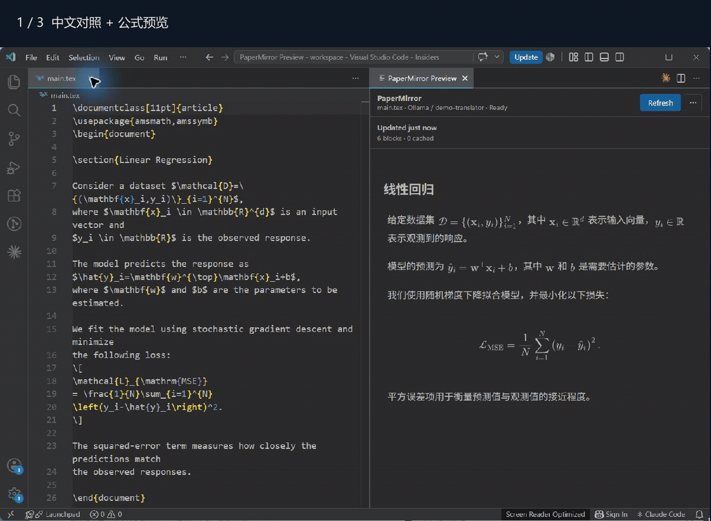

# PaperMirror：写英文论文时，对照中文，看清公式

PaperMirror 是一个 VS Code / Cursor 插件。你在左边编辑英文 LaTeX 或 Markdown 文件，右边就能看到对应的中文和显示出来的公式。修改并保存后，右边的内容也会跟着刷新。

*演示使用固定译文，经过剪辑；实际翻译速度取决于所用模型和接口。*

## 看中文，更快看出哪里不对

中文读起来更快，也更容易抓住重点。写英文论文时，对照中文看一遍，检查起来更省力。

## AI 改完，看看它还动了哪里

有时候只让 AI 改一段，它却顺手改了其他地方。刷新后，PaperMirror 会标出修改、新增和删除的内容，方便你逐处检查。之前翻译过的段落，还能展开看看修改前的中文。点击左边的英文，右边的中文会跳到对应位置，方便来回对照。

保存后标记也会保留，不用一直盯着刷新过程。看完一轮改动后，清除标记，再开始下一轮。

## 公式直接显示出来，检查起来更方便

把 LaTeX 源码里的公式直接显示出来，不用对着一串命令猜公式长什么样。修改公式并刷新后，右边会显示新的公式，也会标出改动的位置，方便检查上下标、分式和括号有没有写错。

第一次打开文件时，译文会逐步出现。之后刷新会复用已有译文，只翻译需要更新的段落。PaperMirror 不修改你的源文件。

## 怎么用

安装插件后：

1. 打开要读或要写的 `.tex`、`.md` 或 `.markdown` 文件。
2. 按 `Ctrl+Shift+P`（macOS 用 `Cmd+Shift+P`），运行 `PaperMirror: Open Preview`。如果还缺少接口配置，会先打开[设置页](#首次设置)；设置好后就能打开中文预览。
3. 照常修改文件，按 `Ctrl+S` 保存。对应的中文和公式会跟着刷新。

检查改动时，看预览里的这些标记：

| 标记 | 怎么看 |
| --- | --- |
| `Edited`，通常是蓝色 | 这部分改过了。点 `Show before`，展开修改前的中文或公式 |
| `New`，通常是绿色 | 新增的内容 |
| `Deleted`，通常是红色 | 内容被删掉了。点 `Show`，展开之前的内容 |

顶部的 `Prev` / `Next` 可以逐处查看，左边的源码也会跳到对应位置。看完后点 `Clear marks` 清掉这一轮的标记，后续修改就从当前内容开始比较。清除标记不会撤销文件里的修改。

如果想自己决定什么时候刷新，在设置页展开“预览和使用习惯”，选择“点击刷新按钮时再刷新”，之后需要时点预览顶部的 `Refresh`。

## 首次设置

### 安装插件

- VS Code：在扩展面板搜索 `PaperMirror`，或打开 [Marketplace 页面](https://marketplace.visualstudio.com/items?itemName=papermirror.papermirror-vscode)。
- Cursor：从 [GitHub Releases](https://github.com/yangkaixin233/PaperMirror/releases) 下载 `.vsix`，运行 `Extensions: Install from VSIX...`，选择下载的文件。VS Code 也可以这样安装。

本说明对应 1.0.0。商店和下载页可能更新不同步，安装时请查看版本号。

### 设置翻译接口

PaperMirror 需要你自己的聊天模型接口，可以用 DeepSeek、OpenAI 等服务，也可以连接本地 Ollama。使用云端服务时，待翻译的文字会发到你配置的接口，费用由该服务按用量收取。

运行 `PaperMirror: Open Settings` 打开中文设置页。也可以直接打开文件并运行 `PaperMirror: Open Preview`，缺少配置时会进入同一个页面。

1. 选择翻译服务，填入该服务的 API key。本地 Ollama 通常不需要密钥。
2. 确认模型名称。DeepSeek 已填入默认模型，也可以改成该接口支持的其他聊天模型；其他服务填写自己账户可用或本地已安装的模型名称。
3. 点“保存并测试连接”。成功后点“打开中文预览”即可。

API key 可以在 [DeepSeek](https://platform.deepseek.com/api_keys)、[OpenAI](https://platform.openai.com/api-keys) 或[硅基流动](https://cloud.siliconflow.cn/account/ak)的官方控制台创建。使用其他接口时，向自己的服务商获取。

需要补填的项目会标出【必填】；已保存的密钥会显示“已保存”，不用重复填写。模型名称可以直接修改，接口地址等选项放在“更多连接设置”里，使用自定义接口时需要填写地址。测试会翻译一句示例文字，可能产生少量接口费用。

其他接口怎么填

在设置页选择服务后，按该服务实际支持的模型填写：

| 翻译服务 | 默认接口地址 | 模型名称 | API key |
| --- | --- | --- | --- |
| DeepSeek | `https://api.deepseek.com` | 已填入默认模型，可修改 | 需要 |
| OpenAI | `https://api.openai.com/v1` | 填写账户可用的聊天模型名称 | 需要 |
| Ollama | `http://localhost:11434/v1` | 填写本地已安装的模型名称 | 通常不需要 |
| 硅基流动 | `https://api.siliconflow.cn/v1` | 填写账户当前可用的聊天模型名称 | 需要 |
| 自定义 | 填写兼容 OpenAI 接口的地址 | 填写该接口支持的模型名称 | 当前需要 |

接口地址不要追加 `/chat/completions`。模型名称以所用服务为准；硅基流动可以在控制台或 [`GET /v1/models`](https://docs.siliconflow.cn/en/api-reference/models/get-model-list) 中查询。

更换接口、模型或密钥后，再点一次“保存并测试连接”。

## 常见问题

长文档翻译慢，或有些段落还没翻译

第一次翻译长文档需要一些时间。把光标放在想先看的位置，PaperMirror 会优先处理附近的内容，再逐段补齐。切换到另一篇文档时，原来的翻译可以在后台继续。后续刷新会复用本地缓存，只请求新增、修改或缺少译文的文字。

某段还在显示英文，可以点该段的 `Retry translation`，或点顶部 `Refresh`。想中途停下来，点 `Stop Translating`，已经翻译好的内容会保留。

连接失败，或一直没有翻译结果

打开设置页，点“保存并测试连接”。缺少信息时，输入框下面会提示需要补填什么；密钥被拒绝、模型不可用或网络不通时，也会显示相应原因。仍有问题时，点“查看日志”，或运行 `PaperMirror: Show Logs` 查看详情。临时网络或服务错误会有限重试。

插件会读取编辑器的 `http.proxy` 设置。网络不通时，也可以检查这一项。

改动标记会保留多久

标记比较的是当前内容与首次预览或上次 `Clear marks` 时的内容。连续保存不会清掉前面的改动；某处改回原样后，那里的标记也会消失。重载编辑器窗口会重新开始记录。关闭再打开 `paperMirror.showChangeMarkers`，会从当前预览开始比较。

默认设置下，外部工具改写已打开、且没有未保存修改的文件时，预览也会刷新。手动模式需要点 `Refresh`。

对照按段落、公式等内容块进行，不是逐字修订记录。大幅重写的段落可能显示为删除和新增。修改前的中文没有可用缓存时，会显示之前的源码。表格数字、图片路径等变化也能留下标记，展开后看到的是修改前的源码。

公式、图表和多文件论文能显示到什么程度

常见的行内、行间公式由内置 MathJax 显示，预览不需要安装 TeX。只改公式时，周围文字通常可以复用已有译文。复杂自定义宏和特殊宏包写法可能无法完整显示；公式是否正确仍需要自己检查，最终 PDF 继续用原来的 LaTeX 工具编译。

目前按单个源文件预览，不递归读取 `\input` / `\include`，也不直接读取 PDF。图、表、TikZ、代码块及暂不支持的环境可能显示为占位，能提取的图表说明会翻译。Markdown 支持常见标题、段落、列表、公式和行内代码，复杂布局可能简化显示。

字体、术语和其他设置

运行 `PaperMirror: Open Settings`，展开“预览和使用习惯”或“高级设置”：

| 位置 | 选项 | 用途 |
| --- | --- | --- |
| 预览和使用习惯 | 什么时候刷新 | 默认保存后自动刷新，也可手动刷新 |
| 预览和使用习惯 | 显示改动标记 | 默认开启，标出修改、新增和删除 |
| 预览和使用习惯 | 中文预览字体、预览字号 | 调整阅读外观 |
| 高级设置 | 术语对照 | 指定希望采用的译法 |
| 高级设置 | 翻译源码注释 | 默认关闭，需要时再开启 |

温度、每次请求的文字量、等待时间等参数也放在高级设置里，正常使用可以保持默认。

怎么重译整篇文件或清理缓存

`PaperMirror: Full Retranslate Current File (Costly)` 会重新请求当前文件，消耗更多 token。

`PaperMirror: Clear Cache` 会清除所有文档的本地译文。单段翻译有问题时，先用 `Retry translation` 即可。

译文和 API key 存在哪里

译文缓存保存在编辑器的扩展存储中，不写入论文目录。设置页填写的 API key 保存在编辑器的 SecretStorage，页面只显示保存状态，不回显密钥。

旧版 `PaperMirror: Set API Key` 命令仍可使用，会打开同一个设置页。`paperMirror.apiKey` 仅为兼容已有配置保留；新密钥请在设置页填写，正在使用的旧配置密钥会在保存时转入安全存储。

遇到问题可以提 [Issue](https://github.com/yangkaixin233/PaperMirror/issues)，附上插件版本、编辑器、接口名称和模型。能复现问题的小例子也很有帮助；贴日志前请去掉密钥和私密内容。

## English

PaperMirror shows Chinese translations and rendered equations beside English LaTeX or Markdown in VS Code / Cursor. Use it while writing, reading source documents, or reviewing edits from a collaborator or AI. Saving refreshes the preview without changing your source file.

The GIF above uses fixed translations and edited timing. Actual translation speed depends on your model and endpoint.

### How to use it

After installation, open a `.tex`, `.md` or `.markdown` file and run `PaperMirror: Open Preview` from the Command Palette. If required connection settings are missing, PaperMirror opens its setup page first. Once configured, the Chinese preview fills in paragraph by paragraph. Edit and save as usual. Click in the English source to scroll the Chinese preview to the matching paragraph.

`Edited`, `New` and `Deleted` show which blocks changed. Click `Show before` to compare earlier text or an equation, or `Show` to read deleted content. `Prev` / `Next` move through the changes and reveal the corresponding source. When you finish reviewing, click `Clear marks` to start comparing from the current content. This does not undo your edits.

### First-time setup

Install from the [VS Code Marketplace](https://marketplace.visualstudio.com/items?itemName=papermirror.papermirror-vscode). In Cursor, download a `.vsix` from [GitHub Releases](https://github.com/yangkaixin233/PaperMirror/releases) and run `Extensions: Install from VSIX...`. This README describes 1.0.0; check the version available on each download page.

PaperMirror uses your own chat-model endpoint. Text to translate is sent to that endpoint, and cloud providers charge for usage. Local Ollama is also supported.

Run `PaperMirror: Open Settings` to open the setup page, or let `PaperMirror: Open Preview` take you there when configuration is incomplete.

1. Choose your provider and enter its API key. Local Ollama usually does not need one; the current Custom provider requires one.
2. Check the model name. DeepSeek has an editable default; other providers need a chat model available to your account or installed locally.
3. Click “保存并测试连接” (Save and test connection), then “打开中文预览” (Open Chinese preview) when the test succeeds.

Create API keys in the official [DeepSeek](https://platform.deepseek.com/api_keys), [OpenAI](https://platform.openai.com/api-keys) or [SiliconFlow](https://cloud.siliconflow.cn/account/ak) console. For a custom endpoint, obtain the key from that provider.

Missing required fields are marked “【必填】”. Saved keys show their status and can be left blank to keep using them. Model names are directly editable; additional connection options and advanced parameters stay collapsed. Custom endpoints require their base URL. Do not append `/chat/completions`. Testing translates one example sentence and may incur a small API charge.

### Notes and troubleshooting

Translation, change markers, supported content and storage

Long files take time on the first pass. Text near the cursor is prioritized, and translation can continue in the background when you switch documents. Later saves reuse cached translations. Use `Retry translation` for an untranslated paragraph, `Refresh` to check for missing translations, or `Stop Translating` to stop while keeping completed results.

Marks compare the current content with the first preview or the last `Clear marks`. They persist across saves; returning a block to its earlier content removes its mark. Reloading the editor starts a new comparison. Re-enabling markers starts from the current preview. In the default save mode, external changes also refresh a tracked, open file if it has no unsaved edits. Set `paperMirror.updateMode` to `manual` if you prefer to click `Refresh` yourself.

Comparison works at block level. A substantial rewrite may appear as a deletion and an addition. Earlier source is shown when its translation is unavailable. Table contents and figure paths can leave marks even though the objects appear as placeholders.

Bundled MathJax renders common formulas without TeX. Custom macros may not display fully; use your usual LaTeX tools for the final PDF. PaperMirror previews one source file at a time and does not follow `\input` / `\include` or read PDFs. Figures, tables, TikZ, code blocks and unsupported structures can appear as placeholders; extractable captions are translated. Common Markdown text, lists, math and inline code are supported, with complex layouts simplified.

For connection failures, open the setup page and click “保存并测试连接”. Field errors identify missing information, and connection errors explain rejected keys, unavailable models or network problems. Use “查看日志” or `PaperMirror: Show Logs` for details, and check the editor's `http.proxy` setting when needed. Temporary failures receive limited retries. `PaperMirror: Full Retranslate Current File (Costly)` uses more tokens; `PaperMirror: Clear Cache` removes cached translations for all documents.

Translations are stored in editor extension storage. Keys entered on the setup page use SecretStorage; the page shows their saved status without displaying the secret. The legacy `PaperMirror: Set API Key` command opens the same page. Existing `paperMirror.apiKey` values remain supported for compatibility; an active legacy key is migrated to SecretStorage when you save through the setup page. Enter new keys on that page.

Font and refresh options are under “预览和使用习惯”. Glossary, comment translation and request parameters are under “高级设置”; the defaults normally work without adjustment.

Report problems in [GitHub Issues](https://github.com/yangkaixin233/PaperMirror/issues) with the extension version, editor, provider, model, a small example and redacted logs.

## License

[MIT](LICENSE)
